<div align="center">

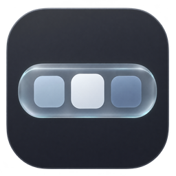

# glassdock

Windows 11 için cam bir dock. Görev çubuğunun yerine geçer, Başlat menüsünü de yeniler.

<a href="https://github.com/medrearalid/glassdock-releases/releases/latest"></a>

<sub>[Neler yeni](https://github.com/medrearalid/glassdock-releases/releases/latest) · [Kurulum](#kurulum) · [Gizlilik](#gizlilik) · [SSS](#sss)</sub>

<br>

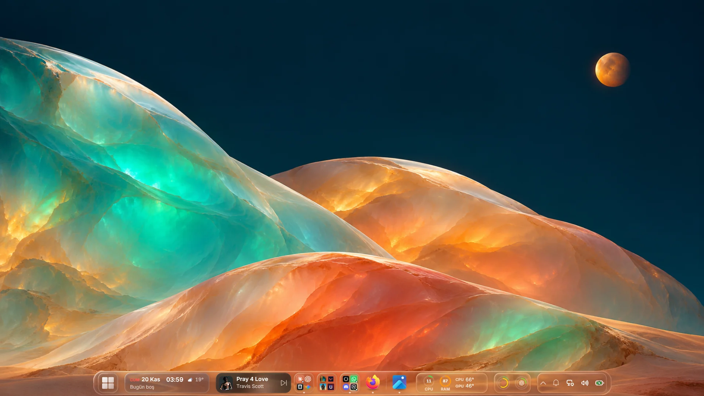

</div>

<br>

## Başlat ve arama

Win tuşuna bas ve yazmaya başla. Uygulamalar, Windows'un bütün ayarları ve dosyaların tek listede gelir, en iyi eşleşme en üstte durur. Arama internete çıkmaz, reklam ya da web sonucu göstermez.

Yazım hatalarını ve baş harfleri anlar. "vsc" yazınca Visual Studio Code bulunur. Ayarlar ana sayfaya değil doğrudan aradığın ayara açılır. Bu Bilgisayar ve Geri Dönüşüm Kutusu da burada, masaüstün boş kalabilir.

<p align="center">
  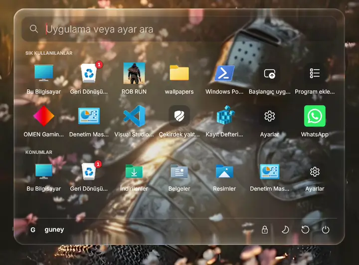
  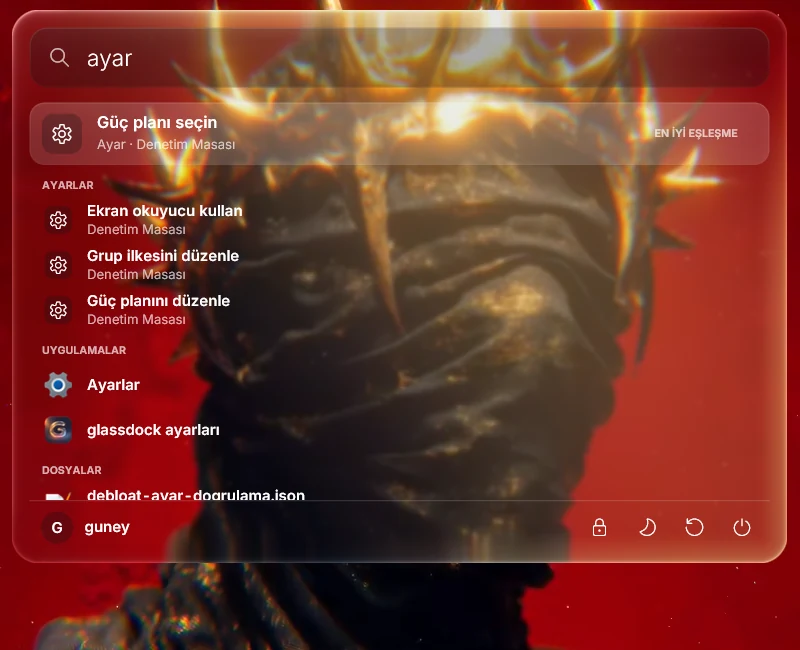
</p>

Windows'un kendi Başlat menüsünü özlersen Ayarlar › Başlat'tan tek dokunuşla geri getirebilirsin.

## Canlı duvar kâğıdı

Bir videoyu ya da hareketli sahneyi duvar kâğıdı yap. Pencereler üstünü kapatınca, oyunda ve pilde kendini uyutur, oyun açılınca belleği de bırakır. Dock'un camı bu hareketi arkasından yansıtır.

<p align="center">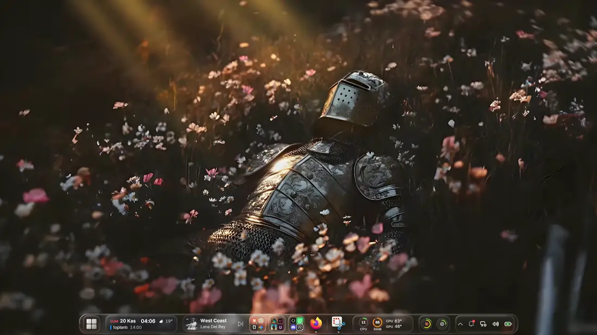</p>

Henüz beta. Ayarlar › Duvar kağıdı sekmesinden açılıyor.

## Her duvar kâğıdında yerinde

Cam, arkasındaki renkleri alır. Kenarlarında ışık mercek gibi kırılır.

<p align="center">
  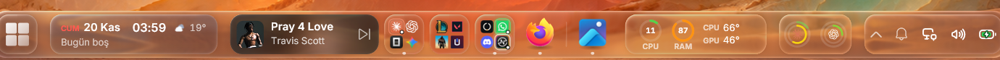<br>
  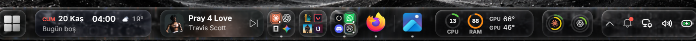<br>
  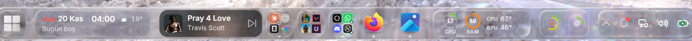
</p>

## Müzik

Çalan şarkı dock'ta görünür. Üstüne tıklayınca açılan panelde sıradakiler, çalma listeleri ve şarkıyla birlikte akan sözler var. Spotify, YouTube Music ve tarayıcıda çalanlarla çalışır.

<p align="center">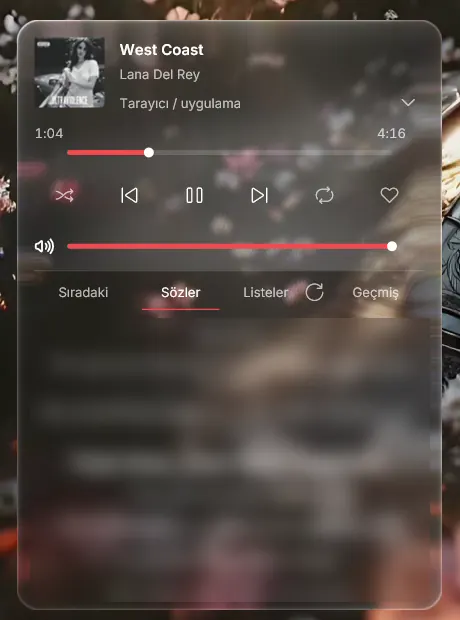</p>

## Gerisi

- **Uygulamalar ve klasörler.** Görev çubuğu sabitlerin kendiliğinden gelir. Açık pencerelerin canlı önizlemesi, sürükle bırak klasörler ve okunmamış mesaj rozetleri var.
- **Widget'lar.** Saat ve hava durumu, takvim, sistem kartı, yapay zekâ kullanım limitleri ve tepsi simgeleri. Her birinin üç boyutu var, üst üste de yığılabilir.
- **Bildirimler.** Windows bildirimleri dock'un kendi kartlarıyla gelir ve tepsideki zilde toplanır. Türkçe yazılan hatırlatıcılar da burada.
- **Akıllı gizlenme.** Bir pencere altına gelince kenara çekilir, imleç kenara gelince döner. Oyunda tamamen kaybolur.
- **Güncellemeler.** Günde bir kez bakar, yeni sürümü doğrulayıp sessizce kurar.

## Kurulum

1. [Son sürümün sayfasından](https://github.com/medrearalid/glassdock-releases/releases/latest) `glassdock-x.y.z-setup.exe` dosyasını indir.
2. Çalıştır. Yönetici izni istemez.
3. Dock ekranın altında açılır. Ayarlar için dock'a sağ tıkla.

Sonrasında glassdock kendini güncel tutar.

<details>
<summary><b>"Windows bilgisayarınızı korudu" uyarısı çıkarsa</b></summary>

<br>

Kurulum dosyası henüz imzalı olmadığı için SmartScreen uyarabilir. Ek bilgi › Yine de çalıştır ile devam edebilirsin. İstersen dosyayı sürümün yanındaki `.sha256` ile karşılaştır.

```powershell
Get-FileHash .\glassdock-x.y.z-setup.exe -Algorithm SHA256
```

</details>

Windows 11, 64 bit gerekir. Kurulum dosyası yaklaşık 5 MB.

## Gizlilik

glassdock hesap istemez, telemetri göndermez. Arama ve Başlat paneli tamamen bilgisayarında çalışır. İnternete yalnızca açtığın özellikler için çıkar.

| Özellik | Bağlandığı yer |
|:--|:--|
| Hava durumu | Open-Meteo |
| Takvim | Eklediğin iCal adresleri |
| Şarkı sözleri | LRCLIB, lyrics.ovh, NetEase |
| Spotify | Bağlarsan yalnızca Spotify |
| Yapay zekâ kullanımı | Bilgisayarındaki Claude, ChatGPT ya da Gemini girişinle ilgili sağlayıcı |
| Güncelleme | GitHub |

Ayarların `%APPDATA%\glassdock` klasöründe durur.

## Duvar kâğıtları

Ekran görüntülerindeki cam duvar kâğıtları burada, hepsi 1672×941. Görsele tıkla ve açılan sayfadan indir. Hepsini birden almak için Code › Download ZIP. Grain sürümlerinde ince bir film greni var.

| | |
|:-:|:-:|
| [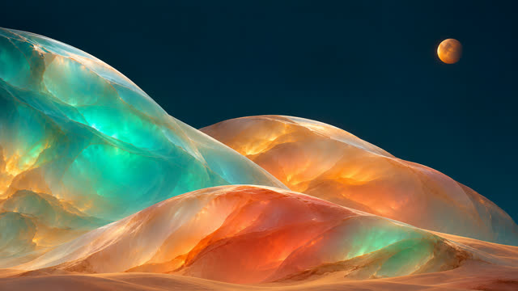](wallpapers/cosmic-opal.png)<br><sub><b>Cosmic Opal</b></sub> | [](wallpapers/chromatic-void.png)<br><sub><b>Chromatic Void</b></sub> |
| [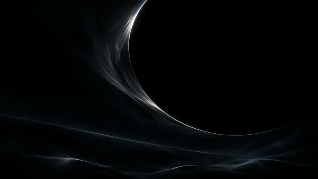](wallpapers/obsidian-void.png)<br><sub><b>Obsidian Void</b></sub> | [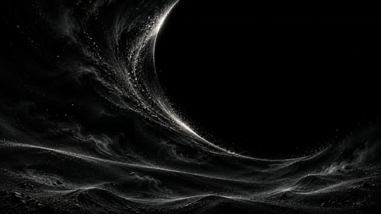](wallpapers/obsidian-void-grain.png)<br><sub><b>Obsidian Void · Grain</b></sub> |
| [](wallpapers/pearl-void.png)<br><sub><b>Pearl Void</b></sub> | [](wallpapers/pearl-void-grain.png)<br><sub><b>Pearl Void · Grain</b></sub> |
| [](wallpapers/chromatic-void-grain.png)<br><sub><b>Chromatic Void · Grain</b></sub> | |

## SSS

<details>
<summary><b>Windows görev çubuğuna ne oluyor?</b></summary>
<br>
glassdock açıkken görev çubuğu gizlenir. Dock kapanınca ya da kaldırılınca olduğu gibi geri gelir.
</details>

<details>
<summary><b>Oyunlarda performansı etkiler mi?</b></summary>
<br>
Tam ekran oyunda dock ve duvar kâğıdı durur, güncellemeler oyun bitene kadar bekler. Eski bilgisayarlarda performans modu animasyonları kapatır.
</details>

<details>
<summary><b>Win tuşu bazen Windows Başlat'ı açıyor</b></summary>
<br>
Oyun sırasında ve yönetici olarak çalışan bir pencere öndeyken Windows kendi menüsünü açar. Bu Windows'un bir sınırı.
</details>

<details>
<summary><b>Nasıl kaldırırım?</b></summary>
<br>
Ayarlar › Uygulamalar › Yüklü uygulamalar › glassdock › Kaldır. Ayarları da silmek istersen <code>%APPDATA%\glassdock</code> klasörünü sil.
</details>

## Geri bildirim

Hata ya da öneri için bir [issue aç](https://github.com/medrearalid/glassdock-releases/issues). Ekran görüntüsü eklersen daha çabuk çözeriz.

## Lisans

© 2026 Guney. Tüm hakları saklıdır. glassdock ücretsizdir ama açık kaynak değildir. Kendi bilgisayarında kullanabilir, duvar kâğıtlarını arka plan yapabilirsin. Yeniden dağıtmak, değiştirmek ya da satmak yazılı izne bağlı. Ayrıntılar [LICENSE](LICENSE) dosyasında.
