<p align="center">
  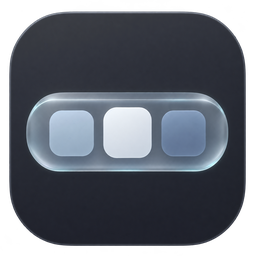
</p>

<h1 align="center">glassdock</h1>

<p align="center">
  Windows 11 için cam görünümlü dock: uygulamalar, widget'lar, takvim ve medya tek bir yerde.
</p>

<p align="center">
  <a href="https://github.com/medrearalid/glassdock-releases/releases/latest"><b>⬇ Son sürümü indir</b></a>
</p>

<p align="center">
  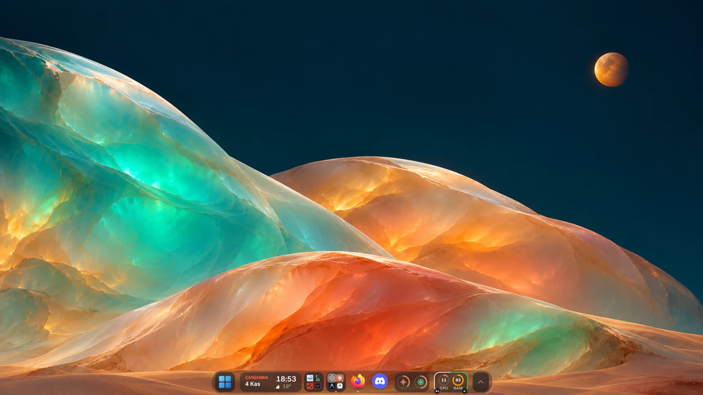
</p>

<p align="center"><sub>Cam, arkasındaki duvar kâğıdına göre renk alır.</sub></p>

<p align="center">
  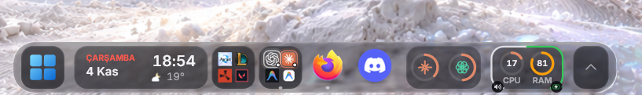<br>
  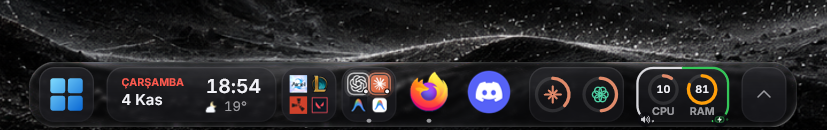<br>
  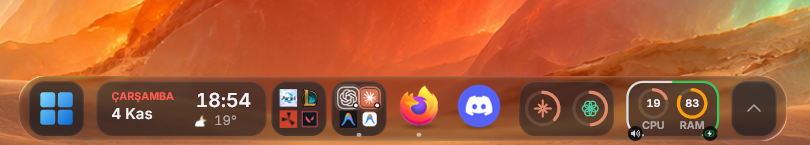
</p>

<p align="center">
  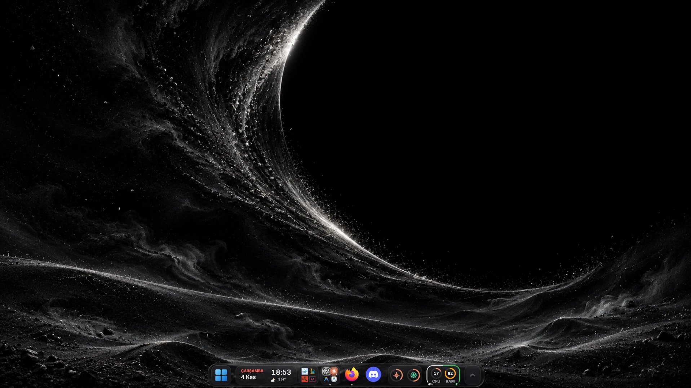
  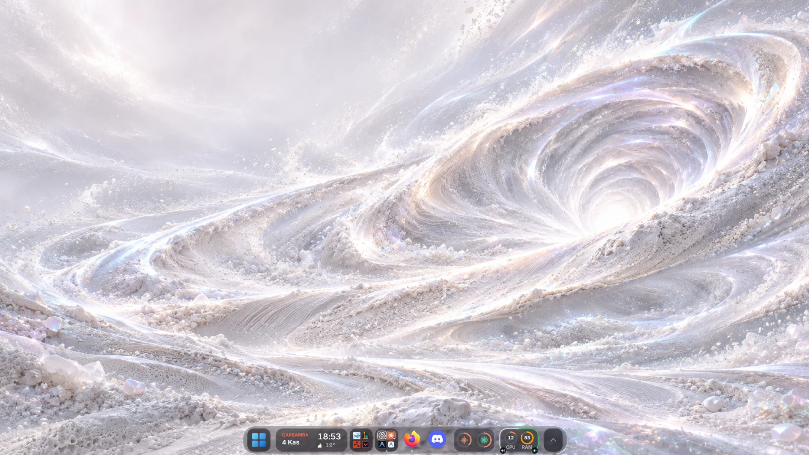
</p>

## Kurulum

1. [Releases](https://github.com/medrearalid/glassdock-releases/releases/latest) sayfasından `glassdock-x.y.z-setup.exe` dosyasını indir.
2. Çalıştır. Yönetici izni gerekmez; kendi kullanıcı klasörüne kurulur.
3. Dock ekranın altında açılır. Ayarlar için dock'a sağ tıkla → **Ayarlar…**

**"Windows bilgisayarınızı korudu" uyarısı:** Kurulum dosyası henüz kod imzalı değil, bu yüzden SmartScreen uyarı verebilir. **Ek bilgi → Yine de çalıştır** ile devam edebilirsin. İstersen indirdiğin dosyayı, sürümün yanındaki `.sha256` dosyasıyla karşılaştır:

```powershell
Get-FileHash .\glassdock-0.4.0-setup.exe -Algorithm SHA256
```

**Gereksinimler:** Windows 11, 64 bit (Windows 10'da denenmedi). Ayarlar penceresi için WebView2 (Windows 11'de zaten yüklü).

## Neler var

- **Cam dock:** Liquid (net, kenarda kırılan) ya da buzlu cam görünüm; glass, midnight ve light temaları. Altta, üstte ya da yanlarda; ortada hap şeklinde ya da kenardan kenara.
- **Uygulamalar:** Görev çubuğu sabitlemeleri otomatik gelir. Açık uygulamalar, pencere önizlemesi, pencere seçici, klasörler ve sürükle-bırak ile sıralama.
- **Animasyonlar:** Genie küçültme efekti, uygulama açılış ve pencere geçiş animasyonları. Hepsini *performans modu* ile kapatabilirsin.
- **Widget'lar:** Saat ve canlı hava durumu, medya kontrolü, takvim, sistem bilgisi, tepsi simgeleri. Her widget'ın küçük, orta ve büyük boyutu var. Widget'ları üst üste yığabilirsin.
- **Yapay zeka kullanımı:** Claude, ChatGPT ve Gemini limitlerini tek bir kartta görürsün. Üstüne gelince tüm limitlerin dökümü açılır.
- **Takvim ve hatırlatıcılar:** Planlayıcı, sesli hatırlatıcı ve bildirim merkezi. Google, Outlook ya da iCloud takvimini iCal adresiyle bağlayabilirsin.
- **Akıllı gizlenme:** Altına bir pencere gelince çekilir, kenara gelince açılır. Tam ekran oyunlarda tamamen gizlenir.
- **Otomatik güncelleme:** Günde bir kez yeni sürüm denetlenir; varsa indirilir, SHA-256 özeti doğrulanır ve sessizce kurulur. Ayarlardan kapatabilirsin.

## Duvar kâğıtları

Ekran görüntülerindeki duvar kâğıtları burada. Görsele tıkla, açılan sayfada **Download raw file** (⬇) düğmesiyle indir. Hepsini birden indirmek için sağ üstteki **Code → Download ZIP** düğmesini kullan. Tüm görseller 1672×941 boyutunda. *Grain* sürümlerinde ince bir film greni var.

| | |
|:-:|:-:|
| [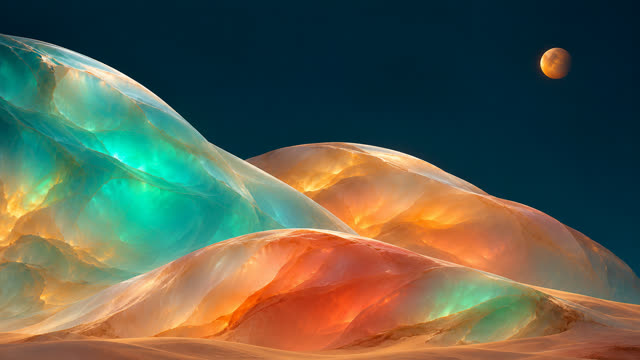](wallpapers/cosmic-opal.png)<br>**Cosmic Opal** | [](wallpapers/chromatic-void.png)<br>**Chromatic Void** |
| [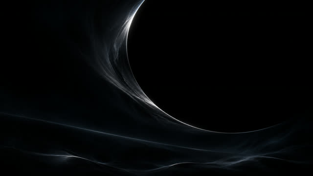](wallpapers/obsidian-void.png)<br>**Obsidian Void** | [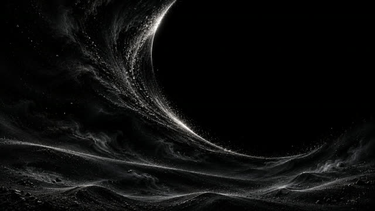](wallpapers/obsidian-void-grain.png)<br>**Obsidian Void · Grain** |
| [](wallpapers/pearl-void.png)<br>**Pearl Void** | [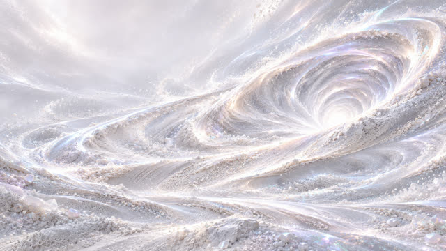](wallpapers/pearl-void-grain.png)<br>**Pearl Void · Grain** |
| [](wallpapers/chromatic-void-grain.png)<br>**Chromatic Void · Grain** | |

## Kaldırma

**Ayarlar → Uygulamalar → Yüklü uygulamalar → glassdock → Kaldır.** Ayarların `%APPDATA%\glassdock` klasöründe durur. Tamamen temizlemek istersen bu klasörü de silebilirsin.

## Geri bildirim

Hata ya da öneri için bir [issue aç](https://github.com/medrearalid/glassdock-releases/issues). Ekran görüntüsü ve Windows sürümünü eklersen hata daha çabuk çözülür.

## Lisans

glassdock ücretsiz kullanılabilir ama açık kaynak değil. Bu depoda yalnızca kurulum dosyaları var. Kişisel kullanım için indirip kurabilirsin. Kurulum dosyalarını başka yerlerde yeniden dağıtmak ya da değiştirerek yayınlamak serbest değil.
